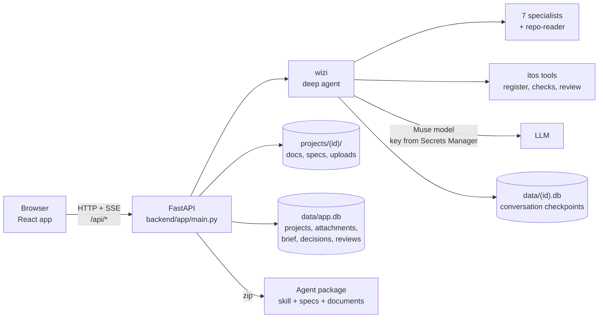
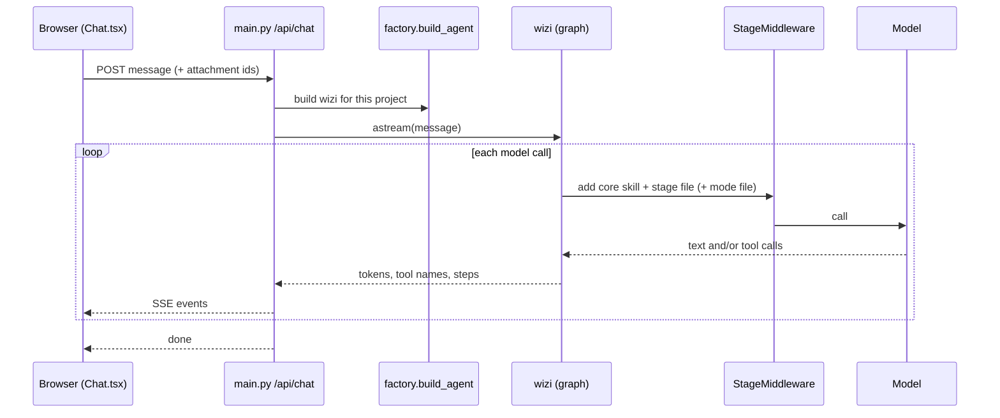

# itos technical guide

How the project is organised, what each part does, and how the parts work together while someone uses the app.
For using the app, see the [user manual](user-manual.md). For the coding-agent side, see
[agent-package-guide.pptx](agent-package-guide.pptx).

## 1. The system in one picture



- **Frontend** (`frontend/`): a React + TypeScript single-page app. It never calls a model; it talks only to `/api`.
- **Backend** (`backend/app/`): FastAPI. `main.py` holds the routes; everything about the agent lives in
  `backend/app/agent/`.
- **wizi** is a LangChain *deep agent* built in `agent/factory.py`. It plans, asks, delegates to specialists and
  writes files. Every write pauses until the user approves it.
- **State** lives on disk: Markdown files per project, one SQLite registry, and one SQLite checkpoint file per project.
- **Output** is two bundles: the documents for people, and a zip "agent package" a coding agent builds from.

## 2. Repository map

### Root

| Path | What it is |
|---|---|
| `CLAUDE.md` | How work is done here: one spec task per session, Verify, then mark it done. Read first. |
| `.ai/specs/` | The plan, as specs `01`–`07` with tasks, status and recorded results. `README.md` is the index. |
| `README.md` | Setup and run commands. |
| `compose.yaml`, `compose.aws.yaml` | Docker stack: `api` + `web`, plus an overlay that mounts `~/.aws` read-only. |
| `.env.example` | Optional settings (port, model name, secret names, limits). Never holds keys. |
| `docs/01-prd.md` … `docs/09-runbook.md` | itos's own nine handover documents (the same set itos produces for others). |
| `docs/guides/` | This guide, the user manual and the decks. |

### Backend: `backend/app/`

| File | Responsibility |
|---|---|
| `main.py` | All HTTP routes: projects, uploads, transcription, the chat stream (SSE), documents, brief and decisions, reviews, package, questions, questionnaires. Routes only: logic lives in the modules below. |
| `schemas.py` | Pydantic models for chat, projects, documents. Mirrored by `frontend/src/api.ts`. |
| `store.py` | Project registry and attachments (SQLite `data/app.db`), document files, the single-file agent bundle, the cached readable bundle. |
| `quality_models.py` | Typed contracts: brief, work items (decisions), findings, reviews, evidence. |
| `quality_store.py` | The brief and the decision register (`project_quality` table): propose, approve, settle from the user's words, answer from a questionnaire, the frontier. |
| `quality.py` | Deterministic checks (security-to-QA mapping, missing documents) and the readiness assessment the brief panel shows. |
| `specs.py` | Reads `projects/<id>/specs/`: which specs or tickets the plan lists and which are still missing. |
| `package.py` | Builds the agent package zip from `package_templates/`, the specs, the documents and the register. |
| `package_templates/` | Fixed files of the package: the coding agent's `SKILL.md`, `procedures/{refine,task,check,commit}.md`, `scripts/check_scope.py`, `questions.md`. |
| `package_checks.py` | Mechanical checks on the package (every task verifiable, links resolve) and reading a returned `questions.md`. |
| `questionnaire.py` | Questionnaire files for stakeholders outside the chat, and applying their answers. |
| `typed_approval.py` | Turns typed or spoken words into a card decision ("looks good" approves; anything else requests changes). |
| `diagrams.py` | Mermaid diagrams (build order, decision graph) built from data for the readable bundle. |
| `source_context.py` | Reads an uploaded source ZIP safely (text only, no dependencies, no `.env`, no traversal) and writes a browsable tree. Never executes code. |
| `secrets.py` | Fetches API keys from AWS Secrets Manager only. |
| `transcription.py` | AssemblyAI upload and polling for voice notes. |

### The agent: `backend/app/agent/`

| File | Responsibility |
|---|---|
| `factory.py` | Builds wizi: model, tools, specialists, middleware, approval rules, write permissions. The only module that imports `deepagents`. |
| `prompts.py` | wizi's identity line plus the core skill, the seven specialist prompts, and `REPO_READER`. |
| `skills/wizi-core/` | wizi's instructions: `SKILL.md` (always loaded), `stages/{discovery,drafting,specs,review}.md`, `modes/{feature,cleanup}.md`. |
| `skills/<playbook>/` | Four review playbooks the specialists and the reviewer apply. |
| `stages.py` | Works out the project's stage, adds that stage's file to the system message before every model call, pins "saved, no card waiting" after approvals, and sends wizi back when it stops with work left. |
| `tools.py` | itos tools wizi calls: project context, propose brief, record and settle decisions, contract checks, package check, independent review, cost estimate. |
| `requirements.py` | The discovery gate (no writes or specialists before the brief is approved; `repo-reader` allowed), and feedback appended to saves (security coverage, spec checks). |
| `harness.py` | Per-run limits, the repeated-failure breaker, model retries and fallback, compaction digest. |
| `review.py` | The independent reviewer: one structured `ReviewDraft`, citations verified against the documents, one corrective retry. |
| `llm.py` | Builds the model client; the key comes from `secrets.py`. |
| `bundles.py` | The readable (plain-language) bundle summary. |
| `quality_skills.py` | Loads skill and stage files from the package, never from arbitrary paths. |

### Elsewhere in `backend/`

| Path | What it is |
|---|---|
| `tests/` | 175 pytest tests. Real-graph tests drive wizi with a scripted model, so no network is needed. |
| `evals/` | Live behaviour evals with the real model: `python -m evals.run`. Cases in `cases.py`, fixtures in `fixtures.py`. |
| `scripts/` | Operational checks (model access, secrets, compose smoke, live flow) and a dev-server restart helper. |
| `data/`, `projects/` | Runtime state (git-ignored). See section 4. |

### Frontend: `frontend/`

| File | Responsibility |
|---|---|
| `src/App.tsx` | Project picker, create, rename, delete; mounts the chat for the chosen project. |
| `src/api.ts` | Typed API client and the SSE stream reader. |
| `src/components/Chat.tsx` | The conversation: sends messages, reads the stream, shows progress, errors, Resend/Delete, the approval card. |
| `src/components/Composer.tsx` | Message box, attachments, voice recording and live transcription. Stays open while a card waits. |
| `src/components/Approvals.tsx` | The approval card: draft preview, Approve & save, Request changes. |
| `src/components/QualityPanel.tsx` | Brief form, decisions list, questionnaire buttons, review and evidence. |
| `src/components/DecisionMap.tsx` | The animated decision map (frontier glowing, arrows from blockers). |
| `src/components/DocViewer.tsx` | Document list, viewer, downloads, package checks, "Bring back questions.md". |
| `src/components/Markdown.tsx`, `MermaidDiagram.tsx` | Safe Markdown rendering; Mermaid blocks drawn in strict mode, loaded only when needed. |
| `src/components/TodoPanel.tsx` | wizi's live plan (to-do list). |
| `src/voice.ts`, `public/audio-capture.js` | Microphone capture, level meter, streaming PCM to AssemblyAI. |
| `nginx.conf` | Production web server: serves the app and proxies `/api` with streaming kept open. |
| `tests/*-smoke.cjs` | Browser smoke scripts (Playwright) for chat, approvals, recovery, voice, project management, quality. |

## 3. How the parts work together

### 3.1 A message, end to end



1. `Chat.tsx` posts to `/api/chat`. If files are attached, the message carries a short preview of each and the path
   of its full saved text (or, for a source ZIP, the source tree for `repo-reader`).
2. `main.py` builds wizi for the project (`factory.build_agent`): the model, tools, specialists, middleware, and the
   checkpointer that remembers the conversation in `data/<id>.db`.
3. Before **every** model call, `StageMiddleware` adds the current stage's instructions. The stage comes from disk
   state, not from what wizi believes: no approved brief → discovery; documents missing → drafting; specs missing →
   specs; otherwise review.
4. The model's tokens and tool calls stream back to the browser as Server-Sent Events: `token`, `tool_call`, `step`,
   `todos`, `interrupt`, `error`, `done`.

### 3.2 Approval cards

Every `write_file` or `edit_file` pauses the graph (`interrupt_on` in `factory.py`). The browser receives an
`interrupt` event and shows the card. The user's choice comes back as `resume` decisions:

- **Approve & save**: the write runs, and the file lands in `projects/<id>/docs/` or `projects/<id>/specs/`.
- **Request changes**: the write is rejected with the user's words, and wizi revises.
- **Typed or spoken** while a card waits: `typed_approval.py` maps "looks good" to approve and any other text to
  request changes. The app decides, never the model.

Write permissions allow only `/docs/**` and `/specs/**`; anything else is refused even when approved.

After an approved save, `stages.py` tells wizi on the next call that the file is saved and no card is waiting. If
wizi still ends its turn with files left to write and no question open, the app sends it back (at most twice).

### 3.3 The four stages

| Stage | Entered when | wizi's work | Key code |
|---|---|---|---|
| discovery | brief not approved | read material, grill in rounds, record decisions, propose the brief | `stages/discovery.md`, `requirements.RequirementsGate`, `tools.propose_*`, `settle_decision` |
| drafting | brief approved, a document missing | delegate to specialists, write the nine documents | `stages/drafting.md`, `prompts.SUBAGENTS` |
| specs | nine documents exist, a planned spec missing | write the plan, conventions, specs or one ticket | `stages/specs.md`, `specs.py`, `SpecCheckFeedback` |
| review | all of the above exist | contract checks, independent review, package check, repairs | `stages/review.md`, `quality.py`, `review.py`, `package_checks.py` |

The brief's intake mode adds `modes/feature.md` or `modes/cleanup.md` in every stage.

### 3.4 Decisions: grilling, the map and questionnaires

- wizi records each open decision with `propose_work_item` (owner, blockers, recommendation) into `project_quality`.
- `quality_store.frontier()` lists the decisions that can be made now; `DecisionMap.tsx` draws them glowing.
- A user's answer settles a decision only through their own words (`settle_decision` checks the words appear in the
  latest message), through a card button, or through a filled questionnaire (`questionnaire.py`).

### 3.5 Uploaded code

`source_context.py` filters the ZIP and writes `projects/<id>/uploads/<attachment>/source/` plus an index. wizi
delegates reading to the `repo-reader` specialist: no register tools, every write denied, its own limits. It returns
a short report citing files, so wizi's own context stays small. Nothing uploaded is ever executed.

### 3.6 The agent package and its return path

`GET /api/projects/<id>/package` → `package.py` assembles:

```text
.claude/skills/build-<project>/   SKILL.md, procedures/, scripts/check_scope.py
.ai/specs/                        the plan, specs or ticket
.ai/handover/                     the nine documents
.ai/decisions.md                  the decision register
.ai/questions.md                  where the coding agent writes what only the owners can answer
AGENTS.md + CLAUDE.md             conventions (or .ai/AGENTS.md for an existing repo)
```

`package_checks.py` checks it (`GET …/package/checks`). When the coding agent writes questions, the user brings
`questions.md` back (`POST …/questions`): each open question becomes a stakeholder decision, wizi asks it, updates
the spec on a card, and the next package carries the answer.

## 4. Where state lives

| Location | Holds |
|---|---|
| `backend/data/app.db` | `projects`, `attachments`, `project_quality` (brief, decisions, reviews, evidence) |
| `backend/data/<id>.db` | the conversation checkpoints (LangGraph) for one project |
| `backend/data/<id>.bundle-readable.md` | the cached readable bundle |
| `backend/projects/<id>/docs/` | the nine documents |
| `backend/projects/<id>/specs/` | plan, conventions, specs, tickets |
| `backend/projects/<id>/uploads/` | uploaded files, extracted text, source trees |
| `backend/projects/<id>/conversation_history/` | older turns folded away by compaction |

In Docker the same data lives in the `itos-data` and `itos-projects` volumes. Deleting a project removes all of it.

## 5. Safety rules built into the code

| Rule | Where it is enforced |
|---|---|
| Keys only from AWS Secrets Manager | `secrets.py`, `llm.py` |
| Uploads are data, never executed | `source_context.py`, the core skill |
| Nothing is written without the user's approval | `interrupt_on` + write permissions in `factory.py` |
| No research, plan or writes before the brief is approved | `requirements.RequirementsGate` |
| wizi never answers its own questions | `quality_store.settle_item` (words must be in the user's message) |
| Runaway loops end with a message, not silence | `harness.breakers()` (call limits, failure breaker) |
| Readiness is claimed only when checks and review support it | `quality.assessment`, `review.py` citation checks |

## 6. Testing and evals

| Command (from `backend/`) | What it proves |
|---|---|
| `uv run pytest -q` | 175 offline tests: routes, stages, gate, approvals, package, checks, graders, real graphs with scripted models |
| `uv run ruff check app tests evals` | lint |
| `uv run python -m evals.run --cases <case> --trials 2` | live behaviour with the real model; results in `evals/results/` |
| `npm run build` (in `frontend/`) | type-check and production build |
| `node tests/<name>-smoke.cjs <playwright>` | browser smoke checks against a running app |

Eval cases: `discovery`, `specs`, `repo-reader`, `questions-back`, `drafting`, `review`, `cleanup`. Their recorded
pass rates and what each run fixed are in `.ai/specs/07-behaviour-evals.md`.

## 7. Changing things safely

- **Add a task:** write it into the right spec in `.ai/specs/`, implement only its files, run its Verify, mark it done.
- **Change how wizi behaves in one stage:** edit `skills/wizi-core/stages/<stage>.md`; keep each rule with its *when*
  and *why*. If the behaviour must hold every time, enforce it in code (`stages.py`, `requirements.py`) and add an
  eval check.
- **Add a tool:** write it in `tools.py`, register it in `factory.py`, add it to the gate's allowlist if discovery
  may use it, and to `harness.READ_ONLY_TOOLS` if it changes nothing.
- **Never** import `deepagents` outside `factory.py`, and never put a key in code, `.env` or a log.
